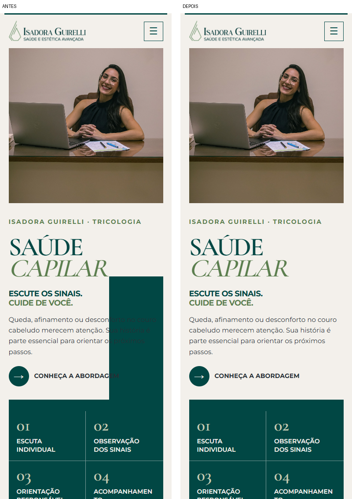
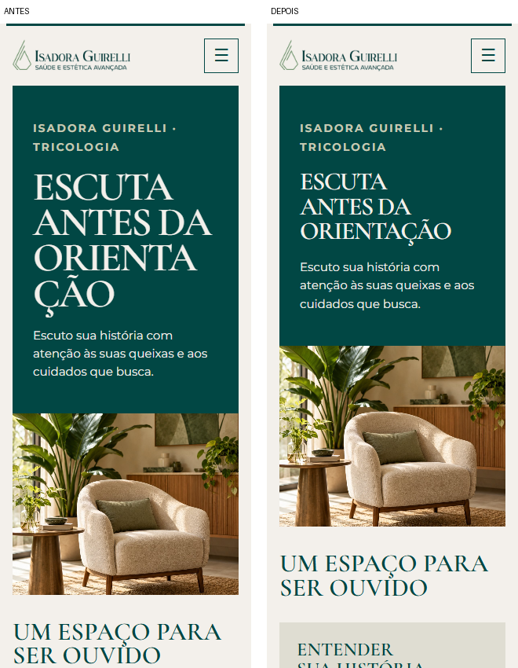
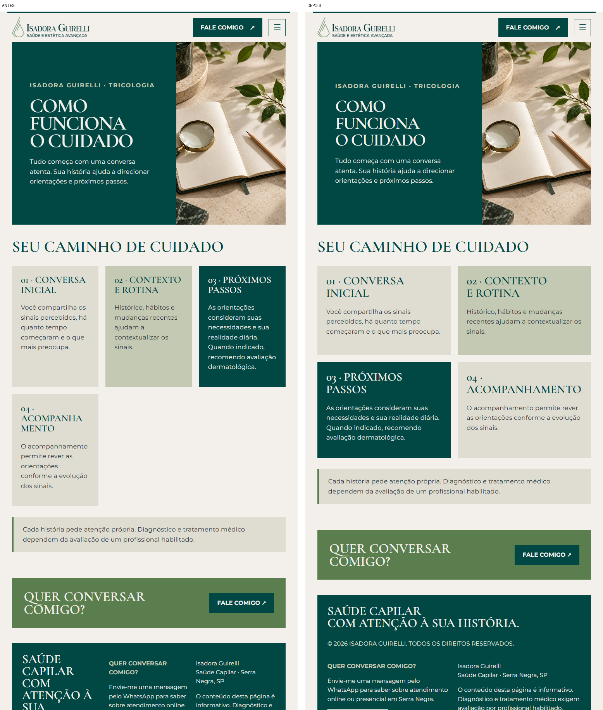

# Relatório de correções e testes

Data: 29/10/2026. Base: `landing-page-isa-repositorio-corrigido.zip`.

## Resultado

As seis páginas foram inspecionadas em capturas completas e testadas com Playwright no Microsoft Edge/Chromium, além da conferência no navegador lateral. As 54 combinações finais de página e viewport passaram sem extravasamentos detectados, texto ultrapassando sua caixa, imagens quebradas ou erros JavaScript. Os 43 registros de testes funcionais e larguras adicionais passaram.

Os seis arquivos HTML são idênticos byte a byte aos do ZIP original. Assim, textos aprovados, seções, ordem, links e metadados foram preservados. Todas as imagens e `whatsapp.js` também são idênticos. A comprovação por SHA-256 está em `relatorio/preservacao.json`.

## Correções verificadas

1. **Início — aprovado.** O painel verde decorativo deixava trechos do texto e do CTA quase ilegíveis no celular. Ele agora fica oculto na disposição vertical. Texto e fotografia têm áreas separadas no tablet e desktop. O título usa o espaço da própria coluna. O cabeçalho “Sinais de atenção” e seu link se empilham no celular. Rótulo de Cuidados, etapas, introdução de contato e botões passam a caber nas colunas.
2. **Sinais — aprovado.** O título principal escala pela largura disponível e mantém palavras inteiras. Conferidos cartões, nota, CTA e rodapé.
3. **Cuidados — aprovado.** Eliminadas quebras como “ENTENDE / R”. Conferidos cartões, nota, CTA e rodapé.
4. **Sobre — aprovado.** Eliminadas quebras no meio de “ORIENTAÇÃO”. Conferidos cartões, nota, CTA e rodapé.
5. **Abordagem — aprovado.** Título principal sem palavras partidas. As quatro etapas ficam em uma coluna no celular e duas nas telas maiores; a quarta deixa de ficar isolada numa coluna estreita. Sua tipografia acompanha a largura do cartão. Conferidos nota, CTA e rodapé.
6. **Contato — aprovado.** Título sem quebra de “CONVERSAR?”. Cartões externos usam uma coluna no celular, duas com introdução acima no tablet e três no desktop. Conferidos âncora de canais, WhatsApp, Instagram e rodapé.

Em todas as páginas, o menu possui altura máxima e rolagem para telas baixas. Abrir o menu leva o foco ao primeiro link, permitindo percorrê-lo por teclado apesar da ordem original do HTML. Escape fecha e devolve o foco ao botão; sair do cabeçalho com Tab e clicar fora fecham o painel. Alternar entre desktop e celular limpa o estado anterior. As preferências de movimento reduzido continuam funcionando.

O README foi atualizado para refletir o WhatsApp ativo e explicar os testes; isso não modifica o conteúdo do site.

## Matriz de telas

| Grupo | Viewport em pixels CSS | Páginas |
|---|---|---|
| Mobile estreito | 320 × 740 | 6/6 |
| Mobile | 390 × 844 | 6/6 |
| Tablet | 768 × 1024 | 6/6 |
| Desktop | 1440 × 900 | 6/6 |
| Ultrawide | 2560 × 1080 | 6/6 |
| Pontos de transição | 520 × 740; 1050 × 800; 1051 × 800 | 6/6 em cada |
| Paisagem | 844 × 390 | 6/6 |

Também foram verificadas automaticamente as seis páginas em 280, 360, 521, 600, 759, 760, 761, 1024, 1200, 1201, 1280 e 1920 px de largura, com altura de 900 px. Nenhum extravasamento ou sobreposição entre os elementos do cabeçalho foi detectado. O menu foi operado em 390 × 280 px.

## Interações e verificação técnica

- Os cinco destinos do menu foram clicados partindo de cada uma das seis páginas: 30 navegações móveis, além do retorno à inicial pelo logo.
- CTAs internos existentes, chamadas “Saiba mais”, links de rodapé e a âncora de canais foram clicados e comparados ao destino previsto.
- Todos os destinos internos únicos por página responderam HTTP 200, e as âncoras apontaram para elementos existentes.
- Links de WhatsApp e Instagram foram clicados, abriram uma nova aba no endereço esperado e mantiveram `noopener`. Para evitar ações externas, o Playwright interceptou a requisição e respondeu localmente. Não houve envio de mensagens; disponibilidade, login e atendimento nos serviços externos não foram validados.
- Verificados abertura/fechamento do menu, Escape com retorno de foco, clique fora, Tab para fora, alternância de tamanho, link “Ir para o conteúdo” e movimento reduzido.
- Conferidos carregamento das imagens, erros JavaScript e extravasamento de conteúdo nas 54 capturas finais.

## Evidências

Abra [a galeria completa](relatorio/index.html): ela apresenta antes e depois de cada página nos nove tamanhos, com links para as imagens originais em resolução integral.

Resultados detalhados: `relatorio/antes/results.json`, `relatorio/depois/results.json` e `relatorio/interacoes.json`. Scripts reproduzíveis em `tests/`; instruções no README.

## Limites

Verificação em navegador real Edge/Chromium com viewports simulados. Não foi executada em aparelhos físicos, Firefox ou Safari. A matriz cobre os tamanhos e transições descritos e não garante toda combinação de tela, zoom, configuração de fonte ou navegador. As fontes continuam dependendo do Google Fonts, como no original. Não foi feita certificação completa de acessibilidade ou validação clínica/editorial. O site foi aberto em prévia local no navegador lateral; não foi publicado em hospedagem pública ou nuvem.
